<div align="right">
  <strong>Languages:</strong>
  <a href="README.md">简体中文</a> |
  <a href="README_EN.md">English</a>
</div>

# QA 现代化自动化测试工程架构规范与使用指南

[](https://github.com/Yotoha0303/QA_Automation_Architecture/actions/workflows/ci.yml)
[](https://github.com/Yotoha0303/QA_Automation_Architecture/actions/workflows/publish_ghcr.yml)
[](https://github.com/Yotoha0303/QA_Automation_Architecture/pkgs/container/qa-runtime)
[](https://github.com/Yotoha0303/QA_Automation_Architecture/releases)
[](LICENSE)
[](requirements.txt)
[](https://playwright.dev/)
[](http://localhost:5050)

本项目严格依据架构设计图实现，采用**云原生容器化 + 宿主混合架构**，解决测试工具链环境冲突、真机调试隔离与 CI/CD 难点。

> 📖 **相关指南与手册**：
> - 📘 [**用户使用说明书 (USER_GUIDE.md)**](USER_GUIDE.md)：面向测试人员的完整实战指南（快速上手、各容器/服务具体用法、用例编写、FAQ）
> - 🛠️ [**脚本使用手册 (脚本使用手册.md)**](脚本使用手册.md)：每个脚本的底层参数、执行流程、安装产物与复原机制说明
> - 📝 [**版本更新日志 (CHANGELOG.md)**](CHANGELOG.md)：从 v1.0.0 到最新版本的核心特性与架构演进记录

---

## 一、架构层级与组件映射

| 层级 | 工具与组件 | 实际部署形式 | 对应目录与配置文件 |
| :--- | :--- | :--- | :--- |
| **1. 宿主环境与桌面工具** | Wireshark, Apifox, VS Code, Docker | Windows / Linux 原生安装 | `scripts/setup_host_tools_windows.bat`<br>`scripts/setup_host_tools_linux.sh` |
| **2. 测试编排与存储依赖** | PostgreSQL, 辅助 Mock 服务 (Prism), Allure Report 可视化报告服务 | 独立容器 | `docker-compose.infra.yml`, `mock-schemas/`, `sql/` |
| **3. 自动化测试运行时** | Python 3.12+, Playwright (POM 架构), k6, apifox-cli | Dev Container 统一镜像 (Compose `test-runner` 服务) | `.devcontainer/Dockerfile`, `.devcontainer/devcontainer.json`, `docker-compose.infra.yml`, `tests/` |
| **4. 移动端支撑层** | Appium Server + 宿主 ADB | 混合架构 | `scripts/start_host_adb.cmd`, `docker-compose.infra.yml` (`appium`, mobile profile), `tests/mobile/` |
| **5. 缺陷管理** | Jira | 官方 SaaS / API Token 集成 | `config/jira_config.env.example`, `conftest.py` |
| **6. 持续集成** | GitHub Actions | 远端托管 Runner / 混合 Runner | `.github/workflows/ci.yml` |

### 架构全景与数据流图 (Architecture & Data Flow)

<p align="center">
  
</p>

<details open>
<summary><b>🔍 点击展开 / 收起交互式 Mermaid 架构全景流向图 (Interactive Mermaid Diagram)</b></summary>



</details>

```mermaid
flowchart TD
    subgraph Host["🖥️ 宿主环境层 (Host Tools & Developer Workspace)"]
        direction TB
        Dev["👤 测试工程师 / CI 流水线"]
        Entry["🚀 一键入口: start.bat / start.sh / clean.bat / clean.sh"]
        CodeIDE["💻 VS Code (附着 Dev Container 模式)"]
        Browser["🌐 Web 浏览器 (访问 Allure 大屏 / Mock 接口)"]
        ApifoxHost["🦊 Apifox Desktop (接口设计与调试)"]
        WireSharkHost["🦈 Wireshark / TShark (底层网络抓包)"]
        ADBHost["📱 宿主 ADB Server (监听 0.0.0.0:5037)"]
        Device["📲 Android 模拟器 / 物理真机"]
        WorkspaceFolder["📂 本地代码仓库 (/workspace 挂载源)"]
        AllureResultsDir["📁 本地测试结果: ./allure-results"]

        Dev --> Entry
        Dev --> CodeIDE
        Dev --> Browser
        Dev --> ApifoxHost
        Dev --> WireSharkHost
        ADBHost <--> Device
    end

    subgraph GHCR_Cloud["☁️ GitHub 容器注册表 (GHCR)"]
        GHCRImage["📦 ghcr.io/yotoha0303/qa-runtime:latest (预编译 6.5GB 镜像)"]
    end

    subgraph Compose["🐳 Docker Compose 基础设施与运行时编排 (qa-infra-net 网桥)"]
        direction TB

        subgraph SvcRuntime["⚡ 层级 3: 自动化测试运行时容器 (qa-test-runner)"]
            PyTest["🧪 Pytest 测试框架 + conftest.py (自动注入 --alluredir)"]
            PlaywrightEng["🎭 Playwright (Chromium / Firefox / WebKit 无头浏览器)"]
            K6Eng["📈 k6 高并发压测引擎"]
            ApifoxCli["🛠️ apifox-cli 自动化命令行"]
            AppiumClient["🔌 Appium Python 客户端"]
        end

        subgraph SvcStorage["🗄️ 层级 2: 存储依赖与 Mock 服务"]
            PG["🐘 PostgreSQL 16 数据库 (qa-postgres:5432)"]
            MockSvc["🎭 Prism HTTP Mock 服务 (qa-mock-service:4010)"]
            MockSchema["📄 mock-schemas/sample_api.yaml (只读契约)"]
            MockSchema --> MockSvc
        end

        subgraph SvcReporting["📊 层级 2: 可视化分析报告服务"]
            AllureSvc["📈 Allure Docker Service (qa-allure:5050)"]
            AllureReportStore[("💾 qa_allure_reports 数据卷")]
            AllureSvc <--> AllureReportStore
        end

        subgraph SvcMobile["📱 层级 4: 移动端自动化桥接"]
            AppiumSvc["🤖 Appium Server 容器 (qa-appium:4723)"]
        end

    end

    subgraph SaaS_Cloud["☁️ 外部云端协同服务 (SaaS)"]
        JiraSaaS["🐞 Jira Cloud REST API (自动化创建 Bug 单)"]
        TargetWeb["🌍 待测外部 Web 站点 / 被测业务系统"]
    end

    %% 数据流连接
    GHCRImage -.->|"免本地编译极速拉取"| SvcRuntime
    WorkspaceFolder <==>|"目录双向同步绑定 (:cached)"| SvcRuntime
    CodeIDE <==>|"vscode-remote 协议穿透挂载"| SvcRuntime

    %% 测试运行数据流
    PyTest -->|"1. 数据库验证与测试数据存取 (5432)"| PG
    PyTest -->|"2. 接口调用与契约测试 (4010)"| MockSvc
    PlaywrightEng -->|"3. E2E 浏览器无头页面渲染与断言"| TargetWeb
    K6Eng -->|"4. 高并发接口阶梯性能压测 (10 VUs)"| MockSvc
    AppiumClient -->|"5. 自动化指令转发 (4723)"| AppiumSvc
    AppiumSvc <==>|"6. 跨主机网关通讯 (host.docker.internal:5037)"| ADBHost

    %% Allure 报告流
    PyTest -->|"7. 自动生成并输出用例 JSON 轨迹"| AllureResultsDir
    AllureResultsDir <==>|"8. 实时监听变动 (每 3 秒检测)"| AllureSvc
    Browser <==>|"9. 直观查阅实时渲染的交互式 Allure 大屏 (5050)"| AllureSvc

    %% 缺陷管理流
    PyTest -.->|"10. 用例失败触发 conftest 钩子提单"| JiraSaaS

    %% 宿主工具直连
    ApifoxHost -.->|"接口联调直连 (localhost:4010)"| MockSvc
    Browser -.->|"健康检查直连 (localhost:4010/api/v1/health)"| MockSvc
```

#### 🔍 架构核心数据流与关键技术选型检索表 (Architecture & Tech Stack Keyword Matrix)

> **SEO 索引与技术规格说明**：为解决图形化流程在搜索引擎爬虫中“不可检索”的问题，以下表格对架构全景图中的核心技术组件、通信协议、服务端口及检索关键词进行结构化索引：

| 核心组件 / 服务名称 | 英文检索关键词 (Keywords) | 部署层级与形态 | 通信协议与端口 | 职责与技术特性 |
| :--- | :--- | :--- | :--- | :--- |
| **Dev Container 运行时** | `Dev Container`, `Python 3.12`, `Playwright`, `k6`, `apifox-cli` | 容器运行时 (`qa-test-runner`) | 内部桥接 (`qa-infra-net`) | 封装无头 Chromium/Firefox/WebKit 浏览器、高并发压测引擎与命令行，环境与宿主机完全隔离 |
| **Web 自动化 POM** | `Page Object Model`, `POM`, `Playwright Python`, `E2E Testing` | 测试用例层 (`tests/web/`) | HTTPS / DOM 树驱动 | 页面元素 Locator 与交互方法封装基类，降低 UI 变动维护成本，实现业务链路断言与表现层彻底解耦 |
| **PostgreSQL 数据库** | `PostgreSQL 16`, `Database Init SQL`, `Seed Data`, `DB Testing` | 存储依赖 (`qa-postgres`) | TCP `5432` | 挂载 `sql/init.sql` 自动执行表结构初始化与预置种子数据，支持 API/DB 自动化用例实时数据存取与断言 |
| **Prism Mock 服务** | `Prism HTTP Mock`, `OpenAPI 3.0`, `Contract Testing`, `API Mock` | 编排服务 (`qa-mock-service`) | HTTP `4010` | 挂载 `sample_api.yaml` 严格遵循 OpenAPI 契约规范，零侵入提供生产级接口模拟，解除后端服务依赖 |
| **Allure 可视化报告** | `Allure Report`, `Allure Docker Service`, `Test Dashboard` | 报告服务 (`qa-allure`) | HTTP `5050` | 监听 `./allure-results` 变动，自动渲染交互式大屏、用例耗时分布柱状图、缺陷分类与执行历史趋势 |
| **ADB 移动端跨主机桥接** | `ADB Bridge`, `Appium Mobile`, `Android Debug Bridge`, `host.docker.internal` | 混合架构 (宿主 + 容器) | TCP `5037`, `4723` | 宿主机 ADB 开放 `0.0.0.0:5037`，容器内 Appium 穿透调用宿主连接的 Android 模拟器或物理真机 |
| **GHCR 预编译镜像** | `GHCR`, `GitHub Container Registry`, `Docker Image Cache`, `Docker CI` | 镜像注册表 (云端托管) | HTTPS `443` | `ghcr.io/yotoha0303/qa-runtime:latest` 预编译 6.5GB 镜像，新开发者免除 15 分钟本地构建，2 分钟极速拉取 |
| **Jira SaaS 自动化提单** | `Jira SaaS REST API`, `conftest.py hook`, `Bug Auto-Reporting` | 外部协同云服务 | HTTPS REST | Pytest 执行失败通过 conftest 钩子自动捕获用例上下文与报错堆栈，通过 REST API 自动提交 Bug 单 |
| **生命周期闭环脚本** | `clean.bat`, `clean.sh`, `Docker Lifecycle`, `Teardown Script` | 运维脚本 (`scripts/`) | Local Shell / PowerShell | 随开随用、用完即净，停止所有容器、释放专用网桥与端口，支持 `-v` 重置持久化卷与 `-a` 深度清理 |

---

## 二、宿主环境部署入口 (Windows & Linux 双平台)

宿主桌面工具通过 `scripts/packages.json` 固化版本，与《软件测试环境安装方式建议》保持一致：

```powershell
winget import -i .\scripts\packages.json --accept-package-agreements --accept-source-agreements
```
清单只包含宿主桌面工具：VS Code、Wireshark、Apifox、Docker Desktop、Git。
Python / Playwright / k6 / adb 等运行时组件只存在于 Dev Container 镜像内，不装入宿主机；PostgreSQL 由 Compose 提供。
`scripts/start.ps1` 会先执行该清单；清单内工具安装成功后，后续步骤不会重复直链安装。
针对无 `winget` 的新装机系统，仍保留直链静默安装入口：

### 🖥️ Windows 宿主机安装
* **方式 1 (最简双击)**：直接双击运行 [`scripts/setup_host_tools_windows.bat`](scripts/setup_host_tools_windows.bat)。它会自动绕过系统脚本执行限制（ExecutionPolicy），检测是否有 `winget`；若无 `winget`，则自动从官方 CDN 直链下载 VS Code、Wireshark、Apifox、Docker Desktop 并静默完成安装。
* **方式 2 (PowerShell 执行)**：
  ```powershell
  powershell -ExecutionPolicy Bypass -File .\scripts\setup_host_tools_windows.ps1
  ```

---

### 🐧 Linux 宿主机安装 (Ubuntu / Debian / Deepin 等)
若您的物理机或服务器为 Linux 环境，进入项目目录执行：
```bash
chmod +x ./scripts/setup_host_tools_linux.sh
sudo ./scripts/setup_host_tools_linux.sh
```
> **该脚本会自动配置并安装**：
> 1. Visual Studio Code (官方 Microsoft APT 源)
> 2. Wireshark / TShark (并配置非 root 抓包用户组)
> 3. Apifox Desktop Linux 官方版
> 4. Docker CE + Docker Compose Plugin
> 5. Android Tools (ADB 移动端连接)

---

## 三、快速开始指南（一键拉起与全流程跑通）

### 一键启动入口（严格按照 6 大架构层级映射）

| 平台 | 入口 | 行为 |
| :--- | :--- | :--- |
| **Windows** (推荐双击或终端) | `start.bat` 或<br>`powershell -ExecutionPolicy Bypass -File .\scripts\start.ps1` | 【层级1: 宿主工具检查】(Wireshark/Apifox/VS Code/Git/Docker)<br>【层级2: 存储依赖】(PostgreSQL 16 + Prism Mock 健康就绪)<br>【层级3: 运行时】(启动 qa-runtime:local / test-runner 容器)<br>【层级4: 移动端】(检测并暴露宿主 ADB 5037 跨容器桥接)<br>【层级5: 缺陷管理】(校验 Jira SaaS 配置与 conftest 提单钩子)<br>【层级6: 全流程测试】(执行 API + Web Playwright + k6 压测并输出架构评分卡) |
| **Linux** (终端执行) | `./start.sh` 或<br>`./scripts/start.sh` | 按照相同 6 大架构层级自动校验宿主工具、拉起 Compose 容器、健康检查就绪并执行全流程无头回归与压测 |

网络环境：所有下载支持国内镜像 / 官方源切换，默认自动探测并缓存。

```powershell
# Windows
.\start.bat -Mirror cn        # 强制国内镜像源
.\start.bat -SkipTests        # 仅拉起环境，不跑测试
.\start.bat -OpenVsCode       # 拉起并附着唤起 VS Code Dev Container
```

```bash
# Linux
./start.sh --mirror cn        # 强制国内镜像源
./start.sh --up-only          # 仅拉起环境，不执行测试
./start.sh --mobile           # 额外拉起 Appium Server 容器
```

常用参数对照：
* Windows: `-RunTests` (默认开启), `-SkipTests`, `-SkipHostTools`, `-SkipMobile`, `-WithMobile`, `-WithPerf` (默认开启), `-SkipPerf`, `-OpenVsCode`, `-Mirror cn|global|auto|cache`
* Linux: `--run-tests` (默认开启), `--up-only` / `--skip-tests`, `--skip-host-tools`, `--skip-mobile`, `--mobile`, `--perf` (默认开启), `--skip-perf`, `--mirror cn|global|auto`

### 一键清理入口（随开随用、用完即净）

测试执行完毕后，执行以下命令即可实现环境生命周期的完整闭环（停止全部容器、释放端口、清理网络与测试缓存）：

| 平台 | 入口 | 说明 |
| :--- | :--- | :--- |
| **Windows** | `.\clean.bat` | 停止所有容器与网络，释放 ADB 5037 端口，清理测试缓存 |
| **Linux** | `./clean.sh` | 停止所有容器，清理测试缓存 |

> 常用清理选项：加 `-v` 可同时清理 Docker 数据卷（PostgreSQL 数据库重置）；加 `-a` 可彻底清理（包含删除本地 6.5GB 镜像）。

### ⚡ 开发者加速：GHCR 预编译镜像

为解决新成员本地编译 6.5GB 镜像耗时过长（15~20 分钟）的痛点，本项目通过 [GitHub Actions](.github/workflows/publish_ghcr.yml) 全自动将测试运行时镜像构建并托管至 **GitHub Container Registry (GHCR)**：
* **公开镜像地址**：`ghcr.io/yotoha0303/qa-runtime:latest`
* **无感加速**：`start.bat` / `start.sh` 在检测到本地无镜像时，将**优先自动从 GHCR 极速拉取预编译镜像**（约 2 分钟），拉取失败或离线时才自动回退为本地 Dockerfile 构建。

### 手动分步执行

#### 第 1 步：启动测试编排与存储依赖 (Postgres + Mock)
在项目根目录运行 Docker Compose：
```bash
docker compose -f docker-compose.infra.yml up -d postgres-db mock-service
```
* PostgreSQL 服务运行在 `localhost:5432`
* Prism HTTP Mock 服务运行在 `http://localhost:4010`

#### 第 2 步：进入 Dev Container 自动化测试运行时
1. 使用 VS Code 打开本项目文件夹 `QA_Automation_Architecture`。
2. 按下 `F1` 输入并选择：`Dev Containers: Reopen in Container`。
3. VS Code 按 `.devcontainer/devcontainer.json` 附着到 `docker-compose.infra.yml` 中的 `test-runner` 服务，
   所有依赖（Python 3.12、Playwright 浏览器、k6、apifox-cli）均在容器内就绪。

#### 第 3 步：运行测试用例
在容器内置终端中直接运行：
```bash
# 1. 运行 API 测试
pytest tests/api/

# 2. 运行 Web Playwright 自动化测试
pytest tests/web/

# 3. 运行 k6 压测基线
k6 run tests/perf/load_test.js
```

#### 第 4 步：移动端支撑层（混合模式）
若需要测试 Android 真机或模拟器：
* **Windows**：`start.ps1` 会自动拉起模拟器并监听宿主 ADB；也可单独双击 `scripts/start_host_adb.cmd`。
* **Appium Server**：以容器方式桥接宿主 ADB：
  ```bash
  docker compose -f docker-compose.infra.yml --profile mobile up -d appium
  ```
* 测试通过 `http://appium:4723`（容器内）或 `http://localhost:4723`（宿主）连接 Appium，Appium 再经 `host.docker.internal:5037` 驱动宿主模拟器/真机。

---

## 四、安装成功手动检查指南 (逐项排查清单)

如果您想手动验证每一个层级与工具是否安装成功、服务是否正常工作，可参考以下检查命令与预期响应：

### 0. 一键快速自动诊断（推荐）
在终端中直接运行自验脚本，自动输出 7 项关键指标评分卡：
```powershell
powershell -ExecutionPolicy Bypass -File .\scripts\3_verify_operational.ps1
```
> 若各项均显示 `√ 正常可用`，说明测试环境完全就绪。

---

### 1. 逐层手动检查对照表

| 架构层级 | 待校验组件 | 手动检查命令 (终端执行) | 预期输出 / 正常现象 |
| :--- | :--- | :--- | :--- |
| **层级 1: 宿主工具** | **VS Code** | `code -v` | 输出版本号（如 `1.132.0`） |
| | **Git** | `git --version` | 输出 `git version 2.x.x` |
| | **Docker 引擎** | `docker info` | 正常打印 Server 概况，无报错 |
| | **Wireshark** | Windows 检查文件路径：<br>`Test-Path "C:\Program Files\Wireshark\Wireshark.exe"` | 输出 `True`，桌面可打开 Wireshark 图形界面 |
| | **Apifox Desktop** | Windows 检查文件路径：<br>`Test-Path "$env:LOCALAPPDATA\Programs\apifox\Apifox.exe"` | 输出 `True`，桌面可打开 Apifox 图形界面 |
| **层级 2: 编排与存储** | **PostgreSQL 16** | `docker inspect -f "{{.State.Health.Status}}" qa-postgres` | 输出 `healthy` (健康就绪) |
| | **Prism Mock** | 浏览器打开或终端请求：<br>`curl http://localhost:4010/api/v1/health` | 返回 HTTP 200 与 `{"status":"UP",...}` JSON |
| **层级 3: 测试运行时** | **统一运行时镜像** | `docker images qa-runtime:local` | 输出镜像信息（约 6.5 GB） |
| | **运行时容器** | `docker compose -f docker-compose.infra.yml ps test-runner` | 状态显示为 `Up` (命令 `sleep infinity`) |
| | **Python 3.12** | `docker compose -f docker-compose.infra.yml exec test-runner python --version` | 输出 `Python 3.12.x` |
| | **Playwright** | `docker compose -f docker-compose.infra.yml exec test-runner playwright --version` | 输出 `Version 1.48.x` |
| | **k6 压测引擎** | `docker compose -f docker-compose.infra.yml exec test-runner k6 version` | 输出 `k6 v2.3.0` |
| | **apifox-cli** | `docker compose -f docker-compose.infra.yml exec test-runner apifox --version` | 输出 apifox 命令行版本号 |
| **层级 4: 移动端支撑** | **宿主 ADB 5037 端口** | Windows: `Get-NetTCPConnection -LocalPort 5037 -State Listen`<br>Linux: `ss -tlpn \| grep 5037` | 存在监听在 `0.0.0.0:5037` 的记录 |
| **层级 5: 缺陷管理** | **Jira 配置** | `cat config/jira_config.env` | 文件存在且包含 `JIRA_SERVER_URL` 等项 |
| **层级 6: 自动化测试** | **API 测试** | `docker compose -f docker-compose.infra.yml exec test-runner pytest tests/api/ -v` | 输出 `4 passed in 0.xx s` (含 Mock 契约与 PostgreSQL 种子数据校验) |
| | **Web Playwright** | `docker compose -f docker-compose.infra.yml exec test-runner pytest tests/web/ -v` | 输出 `2 passed in x.xx s` (含基础渲染与 POM 模式端到端操作) |
| | **k6 并发压测** | `docker compose -f docker-compose.infra.yml exec test-runner k6 run tests/perf/load_test.js` | 输出 `checks_succeeded: 100%`，`p(95)<500ms` 通过 |

---

## 五、开源许可证 (License)

本项目采用 [Apache License 2.0](LICENSE) 开源许可证。商业友好，允许自由修改、分发及商业应用。


