<div align="right">
  <strong>Languages:</strong>
  <a href="README_EN.md">English</a> |
  <a href="README.md">简体中文</a>
</div>

# QA Modern Automation Test Architecture: Cloud-Native & Hybrid Specification

[](https://github.com/Yotoha0303/QA_Automation_Architecture/actions/workflows/ci.yml)
[](https://github.com/Yotoha0303/QA_Automation_Architecture/actions/workflows/publish_ghcr.yml)
[](https://github.com/Yotoha0303/QA_Automation_Architecture/pkgs/container/qa-runtime)
[](https://github.com/Yotoha0303/QA_Automation_Architecture/releases)
[](LICENSE)
[](requirements.txt)
[](https://playwright.dev/)
[](http://localhost:5050)

This project implements a **Cloud-Native Containerized + Host-Hybrid Architecture**, purposefully designed to solve dependency collisions across diverse QA toolchains, ensure physical mobile debugging isolation, and streamline enterprise CI/CD execution.

> 📖 **Related Documentation & Manuals**:
> - 📘 [**User Guide (USER_GUIDE.md)**](USER_GUIDE.md): Practical end-to-end guide for SDETs and QA engineers (quickstart, services, test authoring, FAQ).
> - 🛠️ [**Script Manual (脚本使用手册.md)**](脚本使用手册.md): Low-level parameters, execution flows, installation artifacts, and rollback mechanisms.
> - 📝 [**Changelog (CHANGELOG.md)**](CHANGELOG.md): Complete chronological release history from v1.0.0 to latest.

---

## I. Six-Tier Architecture & Component Mapping

| Tier | Tools & Components | Deployment Form | Directory & Configuration |
| :--- | :--- | :--- | :--- |
| **1. Host Tools & Desktop** | Wireshark, Apifox Desktop, VS Code, Docker Desktop | Windows / Linux Native | `scripts/setup_host_tools_windows.bat`<br>`scripts/setup_host_tools_linux.sh` |
| **2. Storage & Orchestration** | PostgreSQL 16, Prism HTTP Mock, Allure Report Service | Standalone Containers | `docker-compose.infra.yml`, `mock-schemas/`, `sql/` |
| **3. Test Runtime Environment** | Python 3.12+, Playwright (POM Pattern), k6, apifox-cli | Dev Container Unified Image (`qa-test-runner` service) | `.devcontainer/Dockerfile`, `.devcontainer/devcontainer.json`, `docker-compose.infra.yml`, `tests/` |
| **4. Mobile Support Layer** | Appium Server + Host ADB Bridge | Hybrid Cross-Host Architecture | `scripts/start_host_adb.cmd`, `docker-compose.infra.yml` (`appium`, mobile profile), `tests/mobile/` |
| **5. Defect Management** | Jira Cloud SaaS REST API | Official REST SDK Integration | `config/jira_config.env.example`, `conftest.py` |
| **6. Continuous Integration** | GitHub Actions Pipeline | Remote Hosted Runner / Self-Hosted Runner | `.github/workflows/ci.yml` |

---

### Architecture & Data Flow Diagram

<p align="center">
  
</p>

<details open>
<summary><b>🔍 Click to Expand / Collapse Interactive Mermaid Architecture Flowchart</b></summary>



</details>

```mermaid
flowchart TD
    subgraph Host["🖥️ Host Layer (Host Tools & Developer Workspace)"]
        direction TB
        Dev["👤 QA Engineer / CI Runner"]
        Entry["🚀 One-Click Entry: start.bat / start.sh / clean.bat / clean.sh"]
        CodeIDE["💻 VS Code (Dev Container Mode)"]
        Browser["🌐 Web Browser (Allure Dashboard 5050 / Mock UI 4010)"]
        ApifoxHost["🦊 Apifox Desktop (API Design & Debugging)"]
        WireSharkHost["🦈 Wireshark / TShark (Packet Inspection)"]
        ADBHost["📱 Host ADB Server (Listening 0.0.0.0:5037)"]
        Device["📲 Android Emulator / Physical Device"]
        WorkspaceFolder["📂 Local Workspace (/workspace Mount Source)"]
        AllureResultsDir["📁 Local Test Results: ./allure-results"]

        Dev --> Entry
        Dev --> CodeIDE
        Dev --> Browser
        Dev --> ApifoxHost
        Dev --> WireSharkHost
        ADBHost <--> Device
    end

    subgraph GHCR_Cloud["☁️ GitHub Container Registry (GHCR)"]
        GHCRImage["📦 ghcr.io/yotoha0303/qa-runtime:latest (Prebuilt 6.5GB Image)"]
    end

    subgraph Compose["🐳 Docker Compose Infrastructure & Runtime (qa-infra-net Bridge)"]
        direction TB

        subgraph SvcRuntime["⚡ Tier 3: Test Runtime Container (qa-test-runner)"]
            PyTest["🧪 Pytest Framework + conftest.py (Auto-injected --alluredir)"]
            PlaywrightEng["🎭 Playwright (Chromium / Firefox / WebKit Headless Engines)"]
            K6Eng["📈 k6 High-Concurrency Performance Engine"]
            ApifoxCli["🛠️ apifox-cli Automation CLI"]
            AppiumClient["🔌 Appium Python Client"]
        end

        subgraph SvcStorage["🗄️ Tier 2: Storage & Mock Services"]
            PG["🐘 PostgreSQL 16 Database (qa-postgres:5432)"]
            MockSvc["🎭 Prism HTTP Mock Service (qa-mock-service:4010)"]
            MockSchema["📄 mock-schemas/sample_api.yaml (Contract)"]
            MockSchema --> MockSvc
        end

        subgraph SvcReporting["📊 Tier 2: Visual Reporting Service"]
            AllureSvc["📈 Allure Docker Service (qa-allure:5050)"]
            AllureReportStore[("💾 qa_allure_reports Volume")]
            AllureSvc <--> AllureReportStore
        end

        subgraph SvcMobile["📱 Tier 4: Mobile Automation Bridge"]
            AppiumSvc["🤖 Appium Server Container (qa-appium:4723)"]
        end

    end

    subgraph SaaS_Cloud["☁️ External Cloud Services (SaaS)"]
        JiraSaaS["🐞 Jira Cloud REST API (Auto Bug Reporting)"]
        TargetWeb["🌍 System Under Test / Target Web Pages"]
    end

    %% Data Connections
    GHCRImage -.->|"Fast Pull without Local Compilation"| SvcRuntime
    WorkspaceFolder <==>|"Bi-directional Bind Mount (:cached)"| SvcRuntime
    CodeIDE <==>|"vscode-remote Protocol Mount"| SvcRuntime

    %% Test Execution Flow
    PyTest -->|"1. DB Verification & Data Query (5432)"| PG
    PyTest -->|"2. API Calls & Contract Testing (4010)"| MockSvc
    PlaywrightEng -->|"3. E2E Headless Browser Rendering & Assertions"| TargetWeb
    K6Eng -->|"4. High-Concurrency Stress Testing (10 VUs)"| MockSvc
    AppiumClient -->|"5. Automation Commands (4723)"| AppiumSvc
    AppiumSvc <==>|"6. Cross-Host Gateway (host.docker.internal:5037)"| ADBHost

    %% Allure Flow
    PyTest -->|"7. Output Test Execution Traces & Results"| AllureResultsDir
    AllureResultsDir <==>|"8. Realtime Polling (Every 3s)"| AllureSvc
    Browser <==>|"9. Interactive Reporting Dashboard (5050)"| AllureSvc

    %% Defect Flow
    PyTest -.->|"10. Failure Hook Triggers Auto-Issue"| JiraSaaS

    %% Direct Host Links
    ApifoxHost -.->|"API Debugging (localhost:4010)"| MockSvc
    Browser -.->|"Health Check (localhost:4010/api/v1/health)"| MockSvc
```

#### 🔍 Architecture & Tech Stack Keyword Matrix

> **Search Engine Optimization (SEO) & Technical Index**: To ensure all technical capabilities are fully indexable by search engine bots rather than obscured inside canvas diagrams, the table below maps out all core technical components, protocols, ports, and searchable keywords:

| Core Component / Service | Searchable Keywords | Deployment Tier | Protocol & Port | Responsibility & Key Technical Highlights |
| :--- | :--- | :--- | :--- | :--- |
| **Dev Container Runtime** | `Dev Container`, `Python 3.12`, `Playwright`, `k6`, `apifox-cli` | Container Runtime (`qa-test-runner`) | Internal Bridge (`qa-infra-net`) | Encapsulates Chromium/Firefox/WebKit browsers, stress engine & CLI; fully isolated from host environment |
| **Web Automation POM** | `Page Object Model`, `POM`, `Playwright Python`, `E2E Testing` | Test Suite (`tests/web/`) | HTTPS / DOM Tree Driven | BasePage pattern decoupling page Locators and user interactions from assertion logic, minimizing UI test maintenance cost |
| **PostgreSQL Database** | `PostgreSQL 16`, `Database Init SQL`, `Seed Data`, `DB Testing` | Storage Dependency (`qa-postgres`) | TCP `5432` | Mounts `sql/init.sql` for auto-initialization of schema & seed data (`users`, `test_cases`, `test_executions`); verified via pytest |
| **Prism Mock Service** | `Prism HTTP Mock`, `OpenAPI 3.0`, `Contract Testing`, `API Mock` | Service Orchestration (`qa-mock-service`) | HTTP `4010` | Mounts `sample_api.yaml` for OpenAPI 3.0 contract enforcement, eliminating downstream backend dependencies |
| **Allure Report Service** | `Allure Report`, `Allure Docker Service`, `Test Dashboard` | Reporting Service (`qa-allure`) | HTTP `5050` | Polls `./allure-results` every 3s; renders interactive graphs, duration distributions, retry timelines, and defect classification |
| **Cross-Host ADB Bridge** | `ADB Bridge`, `Appium Mobile`, `Android Debug Bridge`, `host.docker.internal` | Hybrid Architecture (Host + Container) | TCP `5037`, `4723` | Exposes host ADB on `0.0.0.0:5037`; enables containerized Appium to drive host emulators or physical Android devices |
| **GHCR Prebuilt Image** | `GHCR`, `GitHub Container Registry`, `Docker Image Cache`, `Docker CI` | Container Registry (GitHub Cloud) | HTTPS `443` | Precompiled 6.5GB image (`ghcr.io/yotoha0303/qa-runtime:latest`) cuts cold-start setup time from 15 minutes down to ~2 minutes |
| **Jira SaaS Integration** | `Jira SaaS REST API`, `conftest.py hook`, `Bug Auto-Reporting` | External SaaS Integration | HTTPS REST | Automatically creates Jira issues with traceback and system metadata upon test failure using Pytest pytest_runtest_makereport hook |
| **Lifecycle Teardown** | `clean.bat`, `clean.sh`, `Docker Lifecycle`, `Teardown Script` | Operational Scripts (`scripts/`) | Local Shell / PowerShell | Ensures "use-and-clean" isolation; stops containers, releases bridge networks & ports; `-v` resets volumes, `-a` removes images |

---

## II. Quick Start Guide (One-Click Launch & Full Regression)

### One-Click Launch Matrix

| Operating System | Entry Point | Behavior & Features |
| :--- | :--- | :--- |
| **Windows** (Double-click or Terminal) | `start.bat` or<br>`powershell -ExecutionPolicy Bypass -File .\scripts\start.ps1` | Verifies host tools (Wireshark/Apifox/VS Code/Git/Docker), boots PostgreSQL + Mock + Allure, pulls/builds Dev Container runtime, bridges host ADB, runs API + Web POM + k6 tests, outputs Scorecard |
| **Linux** (Terminal execution) | `./start.sh` or<br>`./scripts/start.sh` | Executes identical 6-tier pipeline: verifies host tools, starts Compose services, checks health status, and runs headless regression tests |

Common control flags:
```powershell
# Windows Examples
.\start.bat -Mirror cn        # Force domestic mirror sources (npmmirror, Tsinghua, GitHub proxy)
.\start.bat -SkipTests        # Spin up infrastructure and containers without executing tests
.\start.bat -OpenVsCode       # Boot containers and attach VS Code via Dev Container protocol
```

```bash
# Linux Examples
./start.sh --mirror cn        # Force domestic mirror sources
./start.sh --up-only          # Start containers only (skip tests)
./start.sh --mobile           # Start Appium server container for mobile tests
```

---

### Environment Teardown & Lifecycle Management

After test execution, run the cleanup script to close the lifecycle loop (stop all containers, release ports, and clean runtime cache):

| Platform | Command | Description |
| :--- | :--- | :--- |
| **Windows** | `.\clean.bat` | Stops all containers & networks, frees ADB 5037 port, cleans test cache |
| **Linux** | `./clean.sh` | Stops all containers & networks, cleans test cache |

> **Useful flags**: Add `-v` to also remove Docker volumes (reset PostgreSQL database); add `-a` for complete cleanup (including local 6.5GB image removal).

---

### ⚡ Developer Acceleration: Precompiled GHCR Image

To bypass the 15~20 minute local image compilation overhead, this project automatically builds and publishes the test runtime container image to **GitHub Container Registry (GHCR)** via [GitHub Actions](.github/workflows/publish_ghcr.yml):
* **Public Image URL**: `ghcr.io/yotoha0303/qa-runtime:latest`
* **Seamless Acceleration**: `start.bat` and `start.sh` will **automatically attempt pulling the prebuilt image from GHCR first** (~2 minutes), falling back to local Dockerfile compilation only when offline or disconnected.

---

## III. Page Object Model (POM) Web Automation Example

The Web test suite strictly follows the Page Object Model (POM) pattern to isolate UI selectors from business assertions:

```python
# tests/web/pages/playwright_home_page.py
class PlaywrightHomePage(BasePage):
    URL = "https://playwright.dev/"
    GET_STARTED_BUTTON = "text=Get started"

    def navigate(self):
        self.goto(self.URL)
        return self

    def click_get_started(self):
        self.find(self.GET_STARTED_BUTTON).click()

# tests/web/test_web_sample.py
def test_playwright_web_pom_workflow(page: Page):
    home_page = PlaywrightHomePage(page)
    home_page.navigate()
    home_page.verify_page_loaded()
    home_page.click_get_started()
    expect(page).to_have_url(re.compile(r"/docs/intro"))
    home_page.verify_installation_heading()
```

---

## IV. Verification Checklist & Manual Inspection

To verify your installation and service health, execute the operational verification script:

```powershell
powershell -ExecutionPolicy Bypass -File .\scripts\3_verify_operational.ps1
```

Expected Output Scorecard:
```text
================================================================================
               QA Software Test Environment Health Scorecard
================================================================================
Tier         Component          Status      Details
----         ---------          ------      -------
1. Host      Wireshark          √ Ready     C:\Program Files\Wireshark\Wireshark.exe
1. Host      Apifox Desktop     √ Ready     %LOCALAPPDATA%\Programs\apifox\Apifox.exe
1. Host      VS Code            √ Ready     v1.132.0
1. Host      Git                √ Ready     git version 2.55.0
1. Host      Docker Engine      √ Ready     Docker v29.8.2
2. Infra     PostgreSQL 16      √ Healthy   localhost:5432 / qa_testdb (Seed Data Loaded)
2. Infra     Prism Mock         √ Ready     http://localhost:4010 (OpenAPI Contract UP)
2. Infra     Allure Report      √ Ready     http://localhost:5050 (Live Dashboard)
3. Runtime   test-runner        √ Running   qa-test-runner (sleep infinity)
4. Mobile    Host ADB Server    √ Listening 0.0.0.0:5037 Bridge Established
4. Mobile    Appium Server      - On-Demand Use -WithMobile to start container
5. Defect    Jira API Hook      √ Ready     Status: Ready (Auto-ticket creation default false)
6. Execution API Test Suite     √ Passed    Postgres Schema & Mock Contract Tests (4/4)
6. Execution Web Playwright     √ Passed    POM Pattern & E2E Navigation (2/2)
6. Execution k6 Performance     √ Passed    10 VUs Stress Test Baseline p(95)<500ms
6. Execution Mobile Suite       √ Ready     Hybrid Architecture Suite Verified

[All Tests Passed] All 6 architectural tiers operational, 100% test pass rate!
```

---

## V. Open Source License

This project is licensed under the [Apache License 2.0](LICENSE).
Free for commercial use, distribution, and modification.
