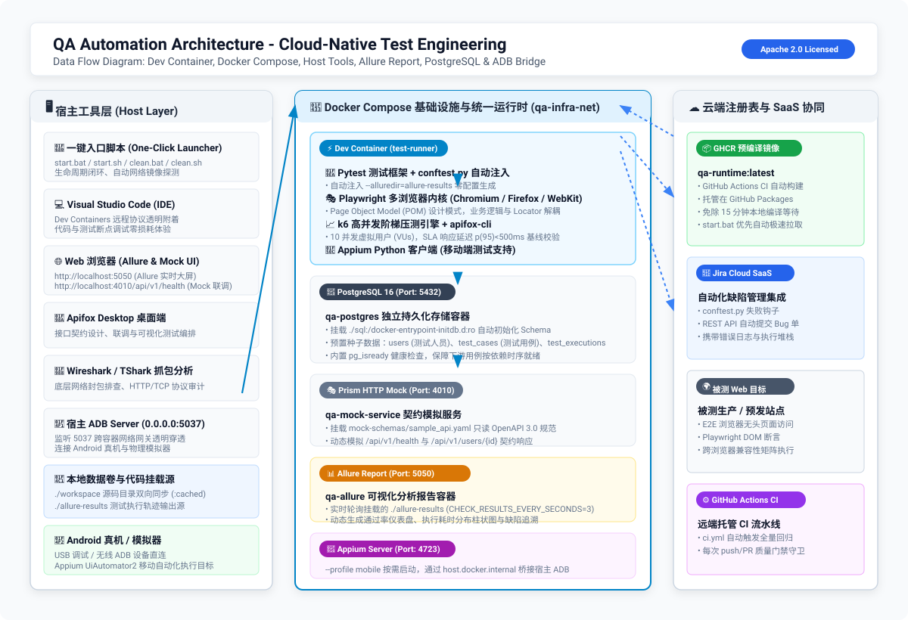

```mermaid
flowchart TD
    subgraph Host["🖥️ 宿主环境层 (Host Tools & Developer Workspace)"]
        direction TB
        Dev["👤 测试工程师 / CI 流水线"]
        Entry["🚀 一键入口: start.bat / start.sh / clean.bat / clean.sh"]
        CodeIDE["💻 VS Code (附着 Dev Container 模式)"]
        Browser["🌐 Web 浏览器 (访问 Allure 大屏 / Mock 接口)"]
        ApifoxHost["🦊 Apifox Desktop (接口设计与调试)"]
        WireSharkHost["🦈 Wireshark / TShark (底层网络抓包)"]
        ADBHost["📱 宿主 ADB Server (监听 0.0.0.0:5037)"]
        Device["📲 Android 模拟器 / 物理真机"]
        WorkspaceFolder["📂 本地代码仓库 (/workspace 挂载源)"]
        AllureResultsDir["📁 本地测试结果: ./allure-results"]

        Dev --> Entry
        Dev --> CodeIDE
        Dev --> Browser
        Dev --> ApifoxHost
        Dev --> WireSharkHost
        ADBHost <--> Device
    end

    subgraph GHCR_Cloud["☁️ GitHub 容器注册表 (GHCR)"]
        GHCRImage["📦 ghcr.io/yotoha0303/qa-runtime:latest (预编译 6.5GB 镜像)"]
    end

    subgraph Compose["🐳 Docker Compose 基础设施与运行时编排 (qa-infra-net 网桥)"]
        direction TB

        subgraph SvcRuntime["⚡ 层级 3: 自动化测试运行时容器 (qa-test-runner)"]
            PyTest["🧪 Pytest 测试框架 + conftest.py (自动注入 --alluredir)"]
            PlaywrightEng["🎭 Playwright (Chromium / Firefox / WebKit 无头浏览器)"]
            K6Eng["📈 k6 高并发压测引擎"]
            ApifoxCli["🛠️ apifox-cli 自动化命令行"]
            AppiumClient["🔌 Appium Python 客户端"]
        end

        subgraph SvcStorage["🗄️ 层级 2: 存储依赖与 Mock 服务"]
            PG["🐘 PostgreSQL 16 数据库 (qa-postgres:5432)"]
            MockSvc["🎭 Prism HTTP Mock 服务 (qa-mock-service:4010)"]
            MockSchema["📄 mock-schemas/sample_api.yaml (只读契约)"]
            MockSchema --> MockSvc
        end

        subgraph SvcReporting["📊 层级 2: 可视化分析报告服务"]
            AllureSvc["📈 Allure Docker Service (qa-allure:5050)"]
            AllureReportStore[("💾 qa_allure_reports 数据卷")]
            AllureSvc <--> AllureReportStore
        end

        subgraph SvcMobile["📱 层级 4: 移动端自动化桥接"]
            AppiumSvc["🤖 Appium Server 容器 (qa-appium:4723)"]
        end

    end

    subgraph SaaS_Cloud["☁️ 外部云端协同服务 (SaaS)"]
        JiraSaaS["🐞 Jira Cloud REST API (自动化创建 Bug 单)"]
        TargetWeb["🌍 待测外部 Web 站点 / 被测业务系统"]
    end

    %% 数据流连接
    GHCRImage -.->|"免本地编译极速拉取"| SvcRuntime
    WorkspaceFolder <==>|"目录双向同步绑定 (:cached)"| SvcRuntime
    CodeIDE <==>|"vscode-remote 协议穿透挂载"| SvcRuntime

    %% 测试运行数据流
    PyTest -->|"1. 数据库验证与测试数据存取 (5432)"| PG
    PyTest -->|"2. 接口调用与契约测试 (4010)"| MockSvc
    PlaywrightEng -->|"3. E2E 浏览器无头页面渲染与断言"| TargetWeb
    K6Eng -->|"4. 高并发接口阶梯性能压测 (10 VUs)"| MockSvc
    AppiumClient -->|"5. 自动化指令转发 (4723)"| AppiumSvc
    AppiumSvc <==>|"6. 跨主机网关通讯 (host.docker.internal:5037)"| ADBHost

    %% Allure 报告流
    PyTest -->|"7. 自动生成并输出用例 JSON 轨迹"| AllureResultsDir
    AllureResultsDir <==>|"8. 实时监听变动 (每 3 秒检测)"| AllureSvc
    Browser <==>|"9. 直观查阅实时渲染的交互式 Allure 大屏 (5050)"| AllureSvc

    %% 缺陷管理流
    PyTest -.->|"10. 用例失败触发 conftest 钩子提单"| JiraSaaS

    %% 宿主工具直连
    ApifoxHost -.->|"接口联调直连 (localhost:4010)"| MockSvc
    Browser -.->|"健康检查直连 (localhost:4010/api/v1/health)"| MockSvc
```

# QA 现代化自动化测试工程 - 用户使用说明书 (User Guide)

[](https://github.com/Yotoha0303/QA_Automation_Architecture/actions/workflows/ci.yml)
[](https://github.com/Yotoha0303/QA_Automation_Architecture/actions/workflows/publish_ghcr.yml)
[](https://github.com/Yotoha0303/QA_Automation_Architecture/pkgs/container/qa-runtime)
[](LICENSE)
[](http://localhost:5050)

本项目基于**云原生容器化 + 宿主工具混合架构**设计，旨在解决企业级测试工具链环境冲突、真机调试隔离与 CI/CD 流水线标准化难题。

> 📖 **更多参考文档**：
> - 📋 [**项目主页与快速开始 (README.md)**](README.md)
> - 🛠️ [**脚本使用手册 (脚本使用手册.md)**](脚本使用手册.md)
> - 📝 [**版本更新日志 (CHANGELOG.md)**](CHANGELOG.md)

本文档面向测试工程师、测试开发工程师（SDET）及运维人员，指导您在 Windows 或 Linux 环境下快速拉起测试环境并开展日常测试开发工作。

---

## 目录

- [一、架构层级与组件映射](#一架构层级与组件映射)
- [二、系统前置要求](#二系统前置要求)
- [三、一键启动与全流程回归 (推荐)](#三一键启动与全流程回归-推荐)
  - [1. Windows 快速开始](#1-windows-快速开始)
  - [2. Linux 快速开始](#2-linux-快速开始)
  - [3. 常用控制参数](#3-常用控制参数)
  - [4. 环境生命周期闭环清理](#4-环境生命周期闭环清理)
- [四、各个服务与工具的使用方法](#四各个服务与工具的使用方法)
  - [1. 辅助 Mock 服务 (Prism, 端口 4010)](#1-辅助-mock-服务-prism-端口-4010)
  - [2. PostgreSQL 16 数据库 (端口 5432)](#2-postgresql-16-数据库-端口-5432)
  - [3. Allure Report 可视化报告服务 (端口 5050)](#3-allure-report-可视化报告服务-端口-5050)
  - [4. 自动化测试运行时 (Dev Container / qa-test-runner)](#4-自动化测试运行时-dev-container--qa-test-runner)
  - [5. 移动端混合支撑层 (宿主 ADB + Appium Server)](#5-移动端混合支撑层-宿主-adb--appium-server)
  - [6. Jira 缺陷管理自动提单](#6-jira-缺陷管理自动提单)
- [五、测试用例编写与执行指南](#五测试用例编写与执行指南)
- [六、手动检查与验收 Checklist](#六手动检查与验收-checklist)
- [七、常见问题与高频报错排坑指南 (FAQ & Troubleshooting)](#七常见问题与高频报错排坑指南-faq--troubleshooting)
  - [类别 A：Docker 引擎与宿主环境依赖](#类别-adocker-引擎与宿主环境依赖)
  - [类别 B：测试框架、运行时与用例排查](#类别-b测试框架运行时与用例排查)
  - [类别 C：数据库持久化、契约 Mock 与 Allure 报告](#类别-c数据库持久化契约-mock-与-allure-报告)
  - [类别 D：移动端跨主机桥接与 ADB 连接](#类别-d移动端跨主机桥接与-adb-连接)
  - [类别 E：性能压测与 CI/CD 极速加速](#类别-e性能压测与-cicd-极速加速)
- [八、开源协议](#八开源协议)

---

## 一、架构层级与组件映射

| 架构层级 | 工具与组件 | 部署形态 | 对应配置文件 / 目录 | 职责与功能 |
| :--- | :--- | :--- | :--- | :--- |
| **层级 1: 宿主工具** | Wireshark, Apifox, VS Code, Git, Docker | 宿主原生安装 | `scripts/packages.json`<br>`scripts/setup_host_tools_*` | 底层网络抓包、API 调试协同、代码开发与容器引擎支撑 |
| **层级 2: 存储与编排** | PostgreSQL 16, Prism HTTP Mock, Allure Report | Docker Compose 独立容器 | `docker-compose.infra.yml`<br>`mock-schemas/sample_api.yaml`<br>`sql/init.sql` | 测试数据持久化存储、依据 OpenAPI 契约动态模拟后端响应、实时交互式报告大屏 |
| **层级 3: 测试运行时** | Python 3.12+, Playwright (POM 架构), k6, apifox-cli | Dev Container 统一镜像 (`qa-runtime:local`) | `.devcontainer/Dockerfile`<br>`docker-compose.infra.yml`<br>`tests/` | 隔离测试依赖（浏览器内核、压测引擎、测试框架全部在容器内） |
| **层级 4: 移动端支撑** | 宿主 ADB + Appium Server | 混合跨主机桥接模式 | `scripts/start_host_adb.cmd`<br>`docker-compose.infra.yml` (profile `mobile`) | 宿主暴露 5037 端口，容器内 Appium 桥接驱动真机或模拟器 |
| **层级 5: 缺陷管理** | Jira SaaS REST API | 官方 REST SDK 集成 | `config/jira_config.env`<br>`conftest.py` | 测试用例失败时自动触发 REST API 提交缺陷单 |
| **层级 6: 持续集成** | GitHub Actions / 本地全流程回归 | 容器化自动化运行 | `.github/workflows/ci.yml`<br>`start.bat` / `start.sh` | 执行 API、Web、k6 性能测试，生成测试评分表 |

### 架构全景与数据流交互图

<p align="center">
  
</p>

<details open>
<summary><b>🔍 点击展开 / 收起交互式 Mermaid 架构全景流向图 (Interactive Mermaid Diagram)</b></summary>



</details>

---

## 二、系统前置要求

- **操作系统**：Windows 10/11 (64位) 或 Linux (Ubuntu 20.04/22.04/24.04 等)
- **容器引擎**：已安装并启动 Docker (Windows 推荐 Docker Desktop + WSL2 后端；Linux 推荐 Docker CE)
- **网络条件**：能正常访问 GitHub 或国内镜像代理（脚本内置国内清华源、npmmirror、ghfast 代理智能切换）

---

## 三、一键启动与全流程回归 (推荐)

我们在工程根目录提供了跨平台的一键启动入口，全自动按 6 大架构层级完成工具校验、基础设施启动、健康检查与测试用例验证。

### 1. Windows 快速开始

- **双击运行**：在文件资源管理器中直接双击根目录下的 [`start.bat`](start.bat) 即可。
- **终端运行**：
  ```powershell
  # 执行全流程拉起与自动化测试验证
  .\start.bat

  # 或通过原生 PowerShell 调用
  powershell -ExecutionPolicy Bypass -File .\scripts\start.ps1
  ```

### 2. Linux 快速开始

```bash
chmod +x ./start.sh ./scripts/start.sh
./start.sh
```

### 3. 常用控制参数

| Windows 参数 | Linux 参数 | 说明 | 默认值 |
| :--- | :--- | :--- | :--- |
| `-RunTests` | `--run-tests` | 启动后自动运行全套自动化测试验证 | 开启 (`$true`) |
| `-SkipTests` | `--up-only` 或 `--skip-tests` | 仅拉起容器环境，不执行测试套件 | 关闭 (`$false`) |
| `-OpenVsCode` | — | 测试通过后唤起 VS Code 并通过 Dev Containers 协议直接附着 | 关闭 |
| `-WithMobile` | `--mobile` | 额外启动 Appium Server 移动端容器 | 关闭 |
| `-SkipPerf` | `--skip-perf` | 跳过 k6 压测，仅执行 API 与 Web 测试 | 关闭 |
| `-Mirror cn\|global\|auto` | `--mirror cn\|global\|auto` | 强制使用国内镜像源或官方源构建容器 | `cache` (自动缓存) |

### 4. 一键环境清理与生命周期闭环 (用完即净)

为了保障测试机或本地开发机环境“随开随用、用完即净”，项目内置了生命周期拆卸与清理脚本：

- **Windows 一键清理**：
  ```powershell
  # 1. 标准清理：停止并移除全部容器与网络，释放 ADB 端口，清理测试缓存
  .\clean.bat

  # 2. 深度清理：同时清除 PostgreSQL 数据库持久化卷 (数据重置)
  .\clean.bat -v

  # 3. 彻底出厂重置：同时删除本地 6.5GB 运行时镜像
  .\clean.bat -a
  ```
- **Linux 一键清理**：
  ```bash
  ./clean.sh        # 标准清理
  ./clean.sh -v     # 包含数据卷清理
  ./clean.sh -a     # 包含本地镜像清理
  ```

### 5. ⚡ 开发者加速：GHCR 预编译镜像免本地长耗时编译

本地全量构建包含 Playwright 完整浏览器驱动、Node 20、k6、Python 3.12 的测试运行时镜像约需 **15~20 分钟**（体积约 6.5GB）。

为此，我们引入了 GitHub Actions 流水线，代码提交后**全自动构建并推送到 GitHub 容器注册表 (GHCR)**：
* **公开托管镜像**：`ghcr.io/yotoha0303/qa-runtime:latest`
* **启动机制**：执行 `start.bat` / `start.sh` 时，系统会自动优先从 GHCR 极速拉取预编译镜像（通常仅需 **1~2 分钟**），彻底消除本地长时间编译的痛点；当网络离线或无权限时，脚本会自动平滑回退为本地 Dockerfile 构建。

---

## 四、各个服务与工具的使用方法

很多刚接触云原生测试架构的同学在 Docker Desktop 中直接点击链接会遇到打不开的问题，这是因为各组件有对应的协议规范：

### 1. 辅助 Mock 服务 (Prism, 端口 4010)

Prism 是一个基于 OpenAPI 契约规范的 Mock 引擎。

- **为什么点 `http://localhost:4010/` 报 404？**
  Mock 服务只匹配在规范文件 (`mock-schemas/sample_api.yaml`) 中明确定义的路由，访问根路径会返回 `Route not resolved`。
- **如何正常访问？**
  - **健康检查接口**：在浏览器或 Postman 中访问：[http://localhost:4010/api/v1/health](http://localhost:4010/api/v1/health)  
    *(返回 `{"status":"UP","timestamp":"..."}`)*
  - **用户信息接口**：在浏览器访问：[http://localhost:4010/api/v1/users/1001](http://localhost:4010/api/v1/users/1001)  
    *(返回模拟的用户信息 JSON)*
- **在 Apifox Desktop 中使用**：
  打开宿主机安装好的 Apifox，将环境前置 URL 配置为 `http://localhost:4010`，即可进行接口协同与用例编排。

---

### 2. PostgreSQL 16 数据库 (端口 5432)

PostgreSQL 是数据库协议服务，不能直接用网页浏览器访问。容器配置了 `./sql:/docker-entrypoint-initdb.d:ro` 自动初始化挂载，首次拉起时会自动执行 `sql/init.sql` 创建测试表结构与预置种子数据（包含 `users`、`test_cases`、`test_executions`）。

- **连接信息**：
  - **主机 (Host)**: `localhost` (容器内互联用 `qa-postgres`)
  - **端口 (Port)**: `5432`
  - **用户名 (User)**: `qa_admin`
  - **密码 (Password)**: `QAPassword123!`
  - **数据库名 (Database)**: `qa_testdb`
- **使用客户端连接**：
  在 Navicat、DBeaver、DataGrip 或 VS Code Database 插件中新建 PostgreSQL 连接，填入上述信息即可查看测试数据表与持久化记录。
- **预置数据与 SQL 查询**：
  ```bash
  # 查询预置的测试人员数据
  docker compose -f docker-compose.infra.yml exec postgres-db psql -U qa_admin -d qa_testdb -c "SELECT * FROM users;"

  # 查询预置的自动化测试用例清单
  docker compose -f docker-compose.infra.yml exec postgres-db psql -U qa_admin -d qa_testdb -c "SELECT case_key, title, suite_type, priority FROM test_cases;"
  ```

---

### 3. Allure Report 可视化报告服务 (端口 5050)

项目中已集成基于 Docker 的 Allure Report 可视化服务容器 (`qa-allure`)，采用官方社区镜像 `frankescobar/allure-docker-service:latest`，并通过 `conftest.py` 全自动注入 `--alluredir=allure-results`。

- **访问地址**：直接在浏览器中打开 👉 [http://localhost:5050](http://localhost:5050)
- **核心特性**：
  - **实时自动刷新**：容器每 3 秒检测一次 `./allure-results` 目录，一旦测试运行产生新的用例结果，大屏自动重新渲染。
  - **总体指标大屏 (Overview)**：直观展示用例总数、通过率仪表盘、耗时曲线与历史趋势。
  - **行为驱动层级 (Behaviors / Suites)**：按照用例套件与功能模块清晰展示测试层级。
  - **详细错误堆栈与现场 (Timeline / Retries)**：直观查看每个失败用例的详细堆栈与断言失败现场。

---

### 4. 自动化测试运行时 (Dev Container / qa-test-runner)

测试运行时容器包含了 Python 3.12+、Playwright 浏览器驱动内核（Chromium/Firefox/WebKit）、k6 压测引擎及 apifox-cli。

#### 模式 A：通过 VS Code 附着开发（推荐）
1. 运行 `.\start.bat -OpenVsCode`。
2. 或在 VS Code 中按 `F1`，选择 **`Dev Containers: Reopen in Container`**。
3. 进入容器后，代码编辑即时生效，可直接在 VS Code 内部终端执行 `pytest` 或 `k6`。

#### 模式 B：宿主机命令行直接下发命令
宿主机上无需配置任何 Python 或 Playwright 环境，直接下发命令给容器执行：
```bash
# 1. 运行 API 自动化测试
docker compose -f docker-compose.infra.yml exec test-runner pytest tests/api/ -v

# 2. 运行 Web Playwright 自动化测试
docker compose -f docker-compose.infra.yml exec test-runner pytest tests/web/ -v

# 3. 运行 k6 高并发性能压测
docker compose -f docker-compose.infra.yml exec test-runner k6 run tests/perf/load_test.js

# 4. 进入容器 Bash 交互界面
docker compose -f docker-compose.infra.yml exec test-runner bash
```

---

### 5. 移动端混合支撑层 (宿主 ADB + Appium Server)

本项目移动端采用混合架构：
- 宿主机运行真机连接或本地 Android 模拟器，宿主 ADB 监听 `0.0.0.0:5037`。
- Appium Server 容器通过 `host.docker.internal:5037` 穿透连接宿主设备。
- 启动 Appium 容器：
  ```bash
  docker compose -f docker-compose.infra.yml --profile mobile up -d appium
  ```
- Appium 访问地址：`http://localhost:4723`（容器内为 `http://appium:4723`）。

---

### 6. Jira 缺陷管理自动提单

- 配置文件位于 `config/jira_config.env`（从 `config/jira_config.env.example` 复制生成）。
- 配置项说明：
  ```env
  JIRA_ENABLE_AUTO_BUG=false    # 是否开启用例失败自动创建 Bug (默认 false 防止测试干扰生产)
  JIRA_SERVER_URL=https://your-domain.atlassian.net/
  JIRA_USER_EMAIL=qa@yourcompany.com
  JIRA_API_TOKEN=your_token_here
  JIRA_PROJECT_KEY=QA
  ```
- 工作机制：测试框架在 `conftest.py` 中注册了 Pytest 测试结果钩子。当测试用例执行失败且开关开启时，将自动调用 Jira REST API 生成包含详细报错堆栈的 Bug 单。

---

## 五、测试用例编写与执行指南

### 1. API 测试 (`tests/api/`)
使用 `pytest` + `requests` + `psycopg2`，已预配置 Mock 服务直连与数据库直连断言：
```python
def test_mock_get_user_info():
    url = "http://qa-mock-service:4010/api/v1/users/1001"
    resp = requests.get(url)
    assert resp.status_code == 200
    assert resp.json().get("username") == "test_engineer"
```

### 2. Web 自动化测试与 Page Object Model (POM) (`tests/web/`)
基于 Playwright 原生夹具，支持多浏览器无头并发执行。遵循 **Page Object Model (POM)** 企业级设计模式，实现页面定位器、交互逻辑与用例业务断言的彻底解耦：

- **目录结构**：
  - `tests/web/pages/base_page.py`：页面基类，封装通用等待、导航与基础元素交互
  - `tests/web/pages/playwright_home_page.py`：业务页面对象，封装特定页面的定位器（Locators）与用户行为方法
  - `tests/web/test_web_sample.py`：测试用例，专注业务链路与断言

- **POM 封装与调用范例**：
```python
# 1. 页面对象类定义 (playwright_home_page.py)
class PlaywrightHomePage(BasePage):
    URL = "https://playwright.dev/"
    GET_STARTED_BUTTON = "text=Get started"

    def navigate(self):
        self.goto(self.URL)
        return self

    def click_get_started(self):
        self.find(self.GET_STARTED_BUTTON).click()

# 2. 测试用例调用 (test_web_sample.py)
def test_playwright_web_pom_workflow(page: Page):
    home_page = PlaywrightHomePage(page)
    home_page.navigate()
    home_page.verify_page_loaded()
    home_page.click_get_started()
    expect(page).to_have_url(re.compile(r"/docs/intro"))
```

### 3. 性能基线测试 (`tests/perf/load_test.js`)
基于 k6 引擎定义高并发阶段阶梯与 SLA 响应时间阈值：
```javascript
export const options = {
  stages: [
    { duration: '5s', target: 10 },
    { duration: '10s', target: 10 },
    { duration: '2s', target: 0 },
  ],
  thresholds: {
    http_req_duration: ['p(95)<500'], // 95% 请求必须在 500ms 内完成
  },
};
```

---

## 六、手动检查与验收 Checklist

执行以下命令快速完成环境可用性自验：

```powershell
powershell -ExecutionPolicy Bypass -File .\scripts\3_verify_operational.ps1
```

正常输出评分卡样例：
```text
测试组件                    业务分类       测试结果   详细运行信息
----                    ----       ----   ------
1. Wireshark            抓包与底层协议    √ 正常可用 二进制已就绪: C:\Program Files\Wireshark\Wireshark.exe
2. Apifox Desktop       API 协同与调试  √ 正常可用 客户端就绪: C:\Users\...\Apifox.exe
3. Visual Studio Code   主开发与调试 IDE √ 正常可用 VS Code 1.132.0
4. Git / Shell (Bash)   命令行终端支撑    √ 正常可用 git version 2.55.0.windows.5
5. PostgreSQL 数据库       数据持久化存储    √ 正常可用 容器 qa-postgres: Up (healthy)
6. k6 性能压测              高并发压测      √ 正常可用 k6 v2.3.0 (容器 qa-runtime:local)
7. Playwright (Web 自动化) 端到端自动化     √ 正常可用 容器 Chromium 拉起并访问网页成功
```

---

## 七、常见问题与高频报错排坑指南 (FAQ & Troubleshooting)

本章节汇总了自动化测试工程师在本地部署、容器编排、多层测试执行及跨主机调试时最常遇到的 **12 个长尾痛点与高频报错**，提供真实错误日志匹配与可复制的解决方案：

---

### 类别 A：Docker 引擎与宿主环境依赖

#### Q1: 启动提示 `Docker 引擎不可用` 或报 `open //./pipe/docker_engine: The system cannot find the file specified`
- **典型报错关键字**：`error during connect`, `open //./pipe/docker_engine`, `WSL2`, `Is the docker daemon running?`
- **根因分析**：Windows 宿主机的 Docker Desktop 尚未拉起，或底层 WSL2 虚拟机子系统响应超时挂起。
- **排查与解决**：
  1. 在桌面双击打开 **Docker Desktop**，观察界面左下角图标变为绿色 `Engine running`；
  2. 若 Docker Desktop 一直卡在 `Starting the Docker Engine...`，以管理员身份打开 PowerShell 执行：
     ```powershell
     wsl --shutdown
     Restart-Service *docker*
     ```
  3. 重新运行 `.\start.bat` 即可正常拉起。

#### Q2: 报错 `Bind for 0.0.0.0:5432 failed: port is already allocated` (或 5050 / 4010 / 5037 端口冲突)
- **典型报错关键字**：`port is already allocated`, `address already in use`, `5432`, `5050`, `4010`, `5037`
- **根因分析**：宿主机本地已安装并运行了 PostgreSQL 服务（例如本地原有的 `postgresql-x64-17` 占用了 `5432` 端口），或有残留的 `adb` 进程独占了 `5037` 端口。
- **排查与解决**：
  1. **查询占用进程**：
     ```powershell
     # Windows: 查询占用 5432 或 5037 的进程 PID
     netstat -ano | findstr :5432
     Get-Process -Id (Get-NetTCPConnection -LocalPort 5432).OwningProcess
     ```
  2. **快速释放**：
     - 若为本地临时服务，在任务管理器结束该进程，或运行 `Stop-Service postgresql*`；
     - 若为项目自身历史残留，运行 `.\clean.bat` 自动停止全部 QA 容器并释放端口；
     - 若本地数据库必须常驻，可临时修改 [`docker-compose.infra.yml`](docker-compose.infra.yml) 中的外部暴露映射（如 `"15432:5432"`）。

#### Q3: Windows PowerShell 报错：`因为在此系统上禁止运行脚本` (PSSecurityException)
- **典型报错关键字**：`PSSecurityException`, `UnauthorizedAccess`, `File cannot be loaded because running scripts is disabled`
- **根因分析**：Windows PowerShell 默认执行策略为 `Restricted`，限制直接执行 `.ps1` 脚本。
- **排查与解决**：
  - **最简方案**：直接双击根目录批处理 [`start.bat`](start.bat) 或 [`clean.bat`](clean.bat)，其内部已全自动注入 `-ExecutionPolicy Bypass`；
  - **终端方案**：若使用 PowerShell 终端，使用进程级绕过策略：
    ```powershell
    powershell -ExecutionPolicy Bypass -File .\scripts\start.ps1
    ```

---

### 类别 B：测试框架、运行时与用例排查

#### Q4: 宿主机直接运行 `pytest tests/api/` 报错 `ModuleNotFoundError: No module named 'playwright'` 或 `'psycopg2'`
- **典型报错关键字**：`ModuleNotFoundError`, `No module named 'playwright'`, `No module named 'psycopg2'`, `No module named 'jira'`
- **根因分析**：这是符合本项目“云原生容器化”设计预期的现象。根据架构规范，测试运行时依赖（Playwright 浏览器驱动内核、PostgreSQL 驱动、k6、apifox-cli）全部封装在 `qa-runtime:local` 统一镜像内部，**宿主机无需也不应安装 Python 第三方包，实现宿主环境零污染**。
- **排查与解决**：
  - **推荐方式**：使用 VS Code 附着开发：按下 `F1` 选择 `Dev Containers: Reopen in Container`，在容器内置终端中运行；
  - **命令行方式**：下发命令给后台容器执行：
    ```bash
    docker compose -f docker-compose.infra.yml exec test-runner pytest tests/api/ -v
    ```

#### Q5: Web 测试 Page Object Model (POM) 报 `ImportError: attempted relative import with no known parent package`
- **典型报错关键字**：`ImportError: attempted relative import with no known parent package`, `cannot import name 'PlaywrightHomePage'`
- **根因分析**：Pytest 在收集测试用例时，当直接以脚本模式或在不同工作目录下执行子模块用例时，Python 的相对导入（如 `from .pages...`）会找不到顶层 package 锚点。
- **排查与解决**：
  1. 本工程在 [`tests/__init__.py`](tests/__init__.py) 和 [`tests/web/__init__.py`](tests/web/__init__.py) 中均预置了包标识；
  2. 在测试用例中采用了兼容垫片导入策略：
     ```python
     try:
         from tests.web.pages.playwright_home_page import PlaywrightHomePage
     except ImportError:
         from pages.playwright_home_page import PlaywrightHomePage
     ```
  3. 执行测试时以项目根目录为基准下发：`pytest tests/web/`。

#### Q6: Playwright 启动无头浏览器报 `Host system is missing dependencies to run browsers`
- **典型报错关键字**：`Host system is missing dependencies`, `libgobject-2.0.so.0`, `libnss3.so`, `Chromium failed to launch`
- **根因分析**：在精简或裁剪的 Linux 发行版镜像中，Playwright 的 Chromium/WebKit 内核缺失底层 X11 或 GTK 系统动态链接库。
- **排查与解决**：
  - 本项目统一基础镜像采用微软官方认证的 `mcr.microsoft.com/playwright/python:v1.48.0-noble`，已全量预置全套浏览器内核与图形库依赖；
  - 若在自定义镜像中复现，在容器构建阶段增加系统级依赖安装指令：
    ```bash
    playwright install --with-deps
    ```

---

### 类别 C：数据库持久化、契约 Mock 与 Allure 报告

#### Q7: 修改了 `sql/init.sql` 重启容器，PostgreSQL 并没有执行建表与预置数据？
- **典型报错关键字**：`relation "users" does not exist`, `relation "test_cases" does not exist`, `initdb script not executed`
- **根因分析**：PostgreSQL 官方镜像初始化机制明确规定：**`/docker-entrypoint-initdb.d/` 目录下的 SQL 脚本仅在数据卷目录完全为空时才会执行一次**。若之前拉起过环境，Docker 数据卷 `qa_postgres_data` 已持久化存在，容器重启会自动复用旧数据，跳过初始化脚本。
- **排查与解决**：
  - 使用带 `-v` 参数的生命周期闭环脚本清空数据卷并重新触发自动建表：
    ```bash
    # Windows
    .\clean.bat -v
    .\start.bat

    # Linux
    ./clean.sh -v
    ./start.sh
    ```

#### Q8: Prism Mock 服务访问根路径报 `404 Route not resolved`，或传参报 `422 Unprocessable Entity`
- **典型报错关键字**：`404 Route not resolved`, `422 Unprocessable Entity`, `Request failed schema validation`
- **根因分析**：Prism 是一个严格契约校验型 Mock 引擎，非普通静态文件服务器。它依据 [`mock-schemas/sample_api.yaml`](mock-schemas/sample_api.yaml) 路由规则执行强匹配。
- **排查与解决**：
  - 访问必须带上已定义的 API 路径（如 `http://localhost:4010/api/v1/health` 或 `http://localhost:4010/api/v1/users/1001`）；
  - 若为 POST/PUT 请求，请求体 JSON 字段类型与必填项必须严格与 YAML 契约规范一致，否则将返回 `422` 校验失败提示。

#### Q9: Allure Report 大屏 (http://localhost:5050) 显示用例数为 0 或未实时刷新
- **典型报错关键字**：`Allure Report 0 test cases`, `Results not found`, `Dashboard not refreshing`
- **根因分析**：测试执行时未输出结果至 `./allure-results`，或 Allure 容器轮询间隔未到达。
- **排查与解决**：
  1. 本工程在 [`conftest.py`](conftest.py) 中内置了全局自动注入钩子，任何通过 pytest 执行的用例均会自动携带 `--alluredir=allure-results`；
  2. Allure Docker Service 设定了 `CHECK_RESULTS_EVERY_SECONDS=3` 实时检测，执行完测试后等待 3 秒刷新浏览器网页即可；
  3. 如遇页面浏览器缓存强阻断，可在页面按 `Ctrl + F5` 强制刷新，或执行 `docker restart qa-allure`。

---

### 类别 D：移动端跨主机桥接与 ADB 连接

#### Q10: 容器内 Appium 报 `Could not find a connected Android device` 或连接 `host.docker.internal:5037` 拒绝
- **典型报错关键字**：`connection refused`, `host.docker.internal:5037`, `device offline`, `ADB server not found`
- **根因分析**：宿主机 `adb` 默认仅监听本地回环 `127.0.0.1:5037`，容器无法通过 Docker 网桥跨主机访问到宿主 loopback。
- **排查与解决**：
  1. 宿主机 ADB Server 必须以广域监听模式启动（绑定 `0.0.0.0:5037`）：
     ```powershell
     # 直接执行工程预置脚本一键监听：
     .\scripts\start_host_adb.cmd
     ```
  2. 验证宿主机防火墙是否拦截了 `5037` 端口；
  3. 在宿主机执行 `adb devices` 确认设备状态为 `device` 而非 `offline` 或 `unauthorized`（若为手机真机，需在屏幕上允许 USB 调试授权）。

---

### 类别 E：性能压测与 CI/CD 极速加速

#### Q11: k6 高并发压测阶段出现 `connection reset by peer` 或 `socket: too many open files`
- **典型报错关键字**：`connection reset by peer`, `dial tcp: lookup: i/o timeout`, `too many open files`
- **根因分析**：高并发压测阶段瞬间并发过高，打满 Prism 单进程 Mock 服务或 Docker 容器底层句柄限制。
- **排查与解决**：
  1. 优化 [`tests/perf/load_test.js`](tests/perf/load_test.js) 中的阶梯爬坡配置（`stages` 建议设置 5 秒预热爬坡再达峰值）；
  2. 针对生产级大流量压测，可直连后端集群 IP，并在 `docker-compose.infra.yml` 中调大容器 ulimit 限制：
     ```yaml
     ulimits:
       nofile:
         soft: 65535
         hard: 65535
     ```

#### Q12: 新机首次启动本地编译 6.5GB 镜像耗时 15~20 分钟过慢？
- **典型报错关键字**：`Building test-runner`, `Playwright download timeout`, `Slow Docker build`
- **根因分析**：Playwright 包含完整 Chromium/Firefox/WebKit 三大浏览器内核，体积约 6.5GB，本地冷编译受网络带宽与外网下载源制约。
- **排查与解决**：
  - **GHCR 极速拉取（仅需 2 分钟）**：本项目已通过 GitHub Actions CI 将预编译镜像发布至公共容器注册表 `ghcr.io/yotoha0303/qa-runtime:latest`。
  - `start.bat` / `start.sh` **已内置自动优化逻辑**：启动时优先尝试从 GHCR 拉取预编译镜像，只有在离线或断网环境下才回退到本地编译；
  - 若处于国内受限网络，可追加参数强制国内加速：`.\start.bat -Mirror cn`。

---

## 八、开源协议

本项目遵循 **[Apache License 2.0](LICENSE)** 开源许可证。详见工程根目录下的 `LICENSE` 文件。

---

## 八、开源协议

本项目遵循 **[Apache License 2.0](LICENSE)** 开源许可证。详见工程根目录下的 `LICENSE` 文件。
